

  

<h1 align="center">wuuud</h1>

  <strong>你的微信数据，由你留存。</strong> 
  在电脑上查看、搜索和导出微信 4.x 聊天记录，生成年度总结。 
  另有 13 组 108 项高级版功能：修改和补录聊天记录、在电脑上收发消息、管理群聊和联系人，还有 AI 助手和在线搜索。

  
  
  

  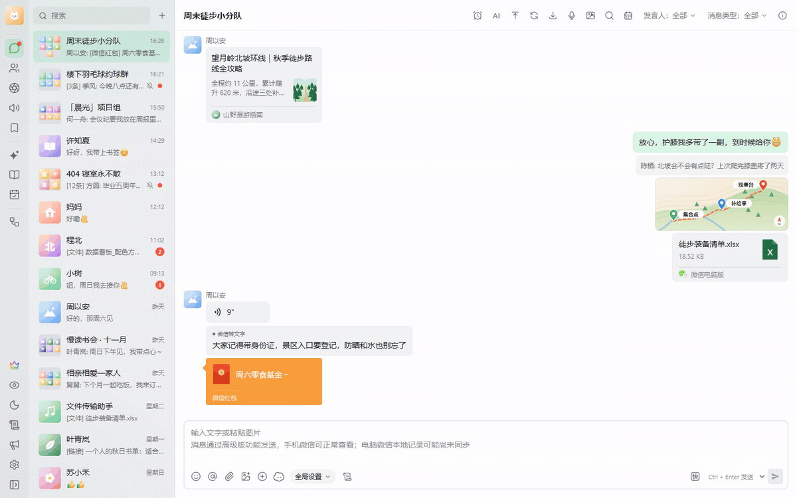

> [!TIP]
> **普通功能免费**：注册 wuuud 账号后，已经添加的微信账号可以免费浏览聊天记录、搜索、实时更新、导出、生成年度总结，也可以用本地模型把语音转成文字。
>
> **添加微信账号**（校验数据库密钥、获取图片密钥）需要在试用期或会员期内完成；macOS 上自动获取数据库密钥也属于高级版功能。
>
> **高级版功能**（消息修改与补录、在电脑上发消息、朋友圈互动、群聊与联系人管理、AI 助手、HTTP API 与 MCP 等）需要开通会员。**符合条件的新用户注册即送 1 天高级版免费试用**。

> [!NOTE]
> 本页的截图和动图都用演示数据录制，里面的人物、头像和聊天内容都是虚构的。截图是默认的新版界面，也可以在「设置 → 外观」里切换成经典界面。

## 目录

- [主要功能](#主要功能)
- [导出](#导出)
- [搜索、收藏与记录](#搜索收藏与记录)
- [联系人与朋友圈](#联系人与朋友圈)
- [年度总结](#年度总结)
- [高级版功能](#高级版功能)
- [下载与安装](#下载与安装)
- [开发者接口](#开发者接口)
- [社区与反馈](#社区与反馈)
- [免责声明](#免责声明)
- [致谢](#致谢)

## 主要功能

- **聊天记录**：浏览所有私聊和群聊。文字、图片、视频、语音、文件、表情、转账、红包、位置、链接、小程序、视频号、引用消息、合并聊天记录、名片、通话记录、拍一拍和实况照片都能显示；可以按消息类型筛选、在群聊里按成员筛选、按日期跳转。
- **实时更新**：电脑微信收到新消息后，wuuud 里的聊天会自动刷新；可以开启新消息弹窗提醒，支持隐藏消息内容、跟随微信免打扰、按黑名单或白名单过滤会话。
- **搜索**：全局搜索联系人、群聊（支持拼音）和聊天记录，结果按会话归类，点一下就能跳回原消息。
- **联系人与群聊**：好友、群聊、企业微信好友和群、公众号、服务号、曾经的好友、黑名单分类查看；群成员列表、好友验证记录都能看，联系人可以导出。
- **记录**：转账与红包、视频号直播、小程序、通话记录、搜索记录、朋友圈消息、撤回记录集中查看。微信收藏可以直接从本机导出；在应用内浏览收藏及其中的图片、视频和文件，需要试用或会员并连接微信。
- **朋友圈**：按联系人浏览本机已缓存的朋友圈，显示本机已有的图片、视频、实况照片和点赞评论；本机没有缓存的图片和视频需要在试用期或会员期内下载。可以按联系人和日期导出。
- **导出**：聊天记录、朋友圈、联系人，以及收藏、好友验证、小程序、视频号直播、转账与红包、服务号记录，都可以导出为 HTML、JSON、TXT、Excel；也可以把整个账号的数据打包成归档，在另一台电脑导入。
- **年度总结**：把一年的聊天做成一组可以翻页的年度报告，可导出图片分享。
- **语音转文字**：用下载到本机的模型把语音转成文字，可逐条转写、批量转写，导出聊天时也能顺带转写。
- **使用体验**：多账号切换，不同窗口可以同时看不同账号；隐私模式一键模糊头像、名称和消息内容；深色模式；新版界面和经典界面可切换；应用内自动更新。
- **高级版功能**：见[下文](#高级版功能)。

<table>
  <tr>
    <td align="center"><b>浅色</b></td>
    <td align="center"><b>深色</b></td>
  </tr>
  <tr>
    <td>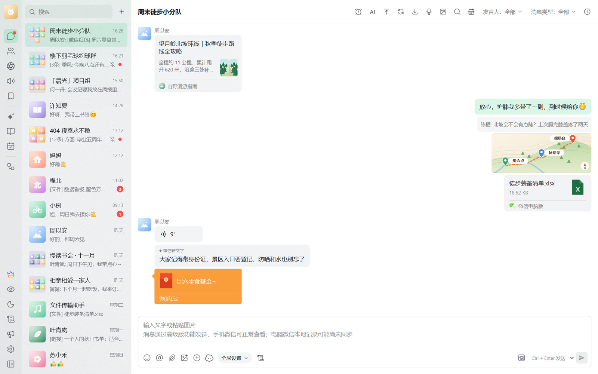</td>
    <td>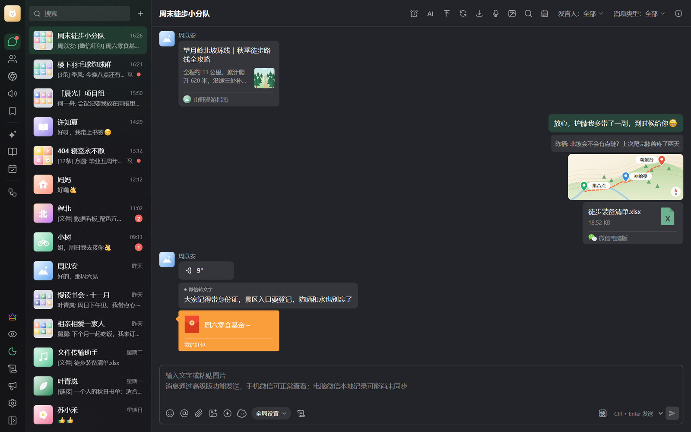</td>
  </tr>
</table>

## 导出

选择会话范围、文件格式、消息类型和时间范围，可以一次性导出成 ZIP，也可以导出到一个目录，之后持续增量更新。开启隐私模式时导出聊天记录，会隐藏身份和消息正文，且不包含头像、图片、视频等媒体，也不会顺带转写语音。

  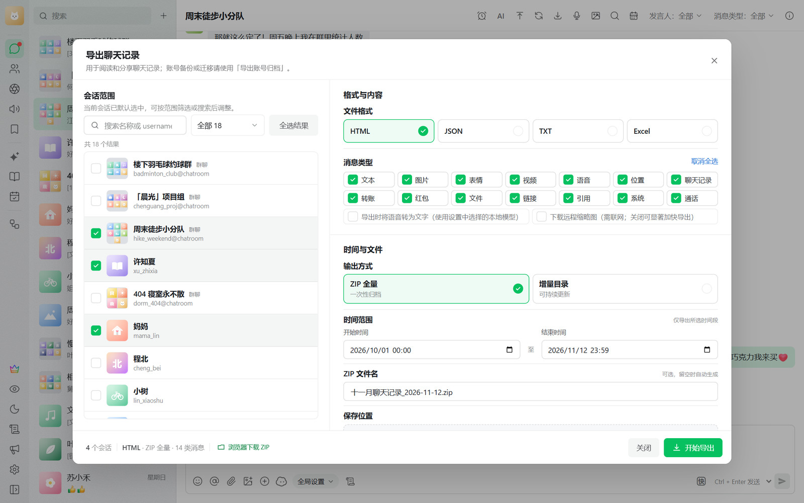

| 内容 | 支持格式 | 导出范围 / 说明 |
| --- | --- | --- |
| 聊天记录 | HTML / JSON / TXT / Excel（.xlsx）；ZIP 全量或增量目录 | 当前会话、全部、群聊、单聊或自选会话；可按消息类型和时间筛选，可在导出时把语音转成文字 |
| 朋友圈 | HTML / JSON / TXT / Excel；ZIP 全量或文件夹增量 | 指定联系人，可选起止日期；图片和视频按发布时间命名 |
| 联系人 | HTML / JSON / TXT / Excel | 按联系人分类和关键词导出 |
| 收藏 | HTML / JSON / TXT / Excel | 按收藏类型、关键词和日期筛选 |
| 好友验证 | HTML / JSON / TXT / Excel | 按发起方向、关键词和日期筛选 |
| 小程序 | HTML / JSON / TXT / Excel | 按关键词和日期筛选 |
| 视频号直播 | HTML / JSON / TXT / Excel | 按关键词和日期筛选 |
| 转账与红包 | HTML / JSON / TXT / Excel | 按类型、状态、关键词和日期筛选 |
| 服务号记录 | HTML / JSON / TXT / Excel | 按服务号和日期导出 |
| 账号数据归档 | ZIP | 可选聊天数据、资源文件或两者；包含聊天数据的归档可以在另一台电脑导入，请妥善保管 |

## 搜索、收藏与记录

全局搜索联系人、群聊和聊天记录，结果按会话归类，点一下跳回原消息。微信收藏、小程序、视频号直播、转账与红包、通话记录等记录分页查看。

  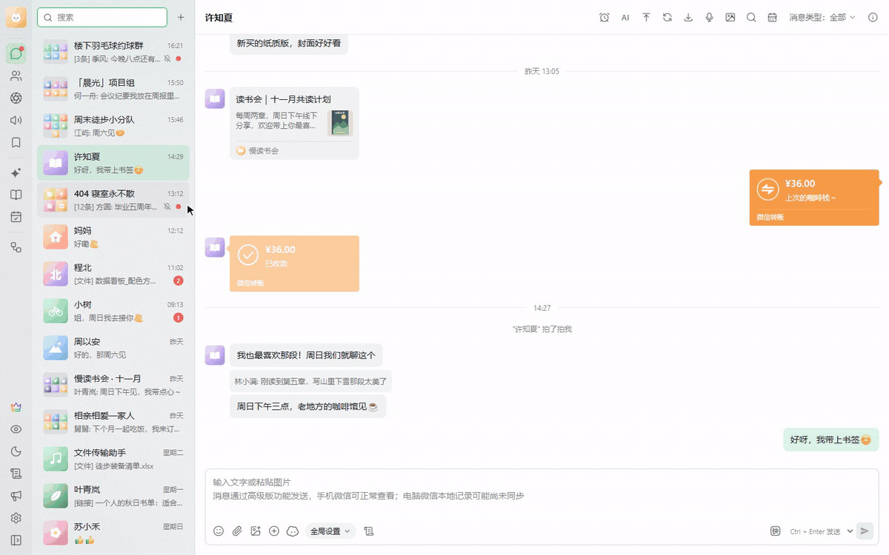

<table>
  <tr>
    <td align="center"><b>微信收藏</b></td>
    <td align="center"><b>收藏的聊天记录</b></td>
    <td align="center"><b>视频号直播</b></td>
  </tr>
  <tr>
    <td></td>
    <td>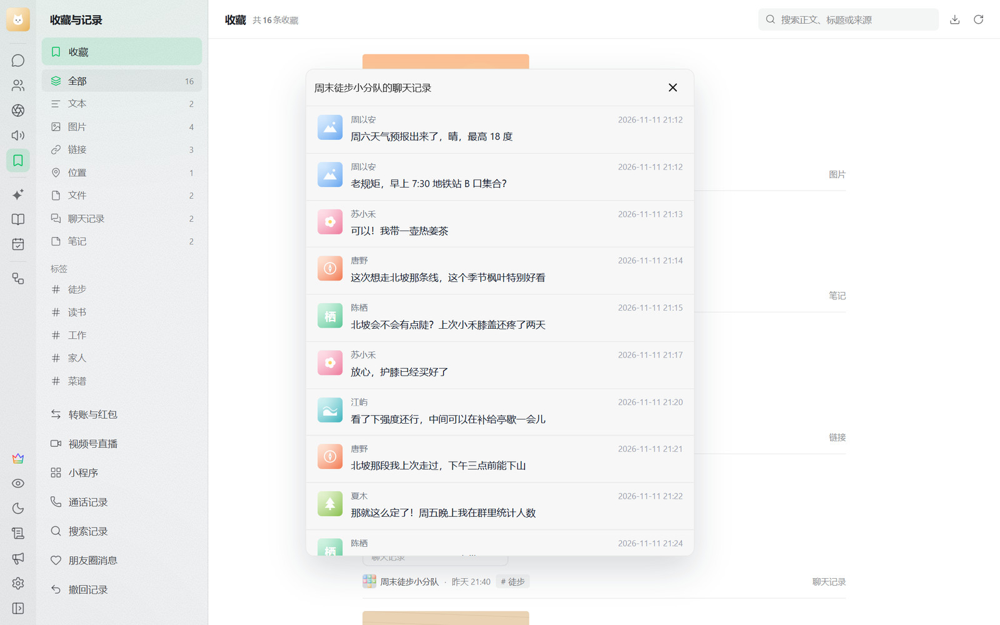</td>
    <td>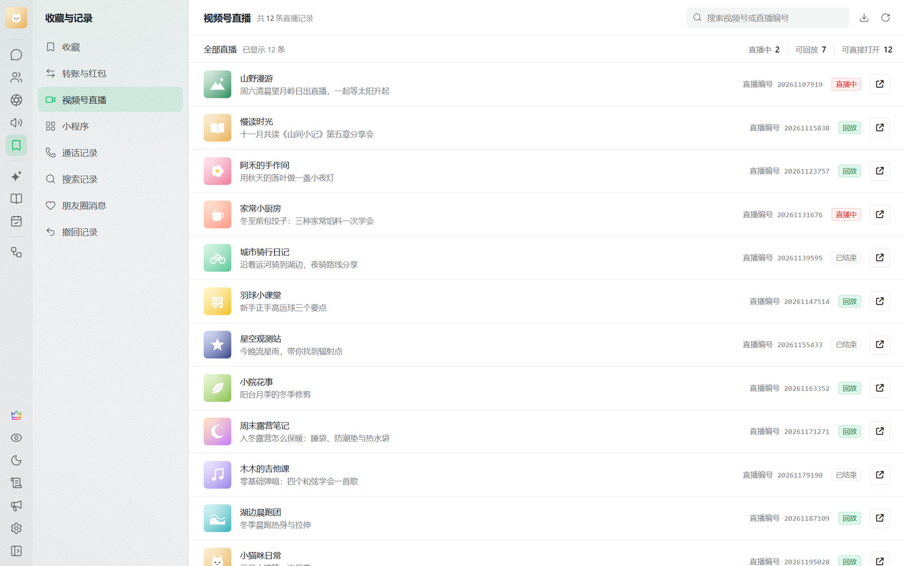</td>
  </tr>
</table>

## 联系人与朋友圈

联系人按好友、群聊、公众号、服务号等分类，列出地区和添加来源；在群聊里打开群成员，可以查看成员资料卡和共同群聊。朋友圈按联系人浏览本机已缓存的动态，配图、位置、点赞和评论都会显示，在左侧选中一位联系人就只看这个人的朋友圈。

<table>
  <tr>
    <td align="center"><b>联系人</b></td>
    <td align="center"><b>群成员资料卡</b></td>
  </tr>
  <tr>
    <td>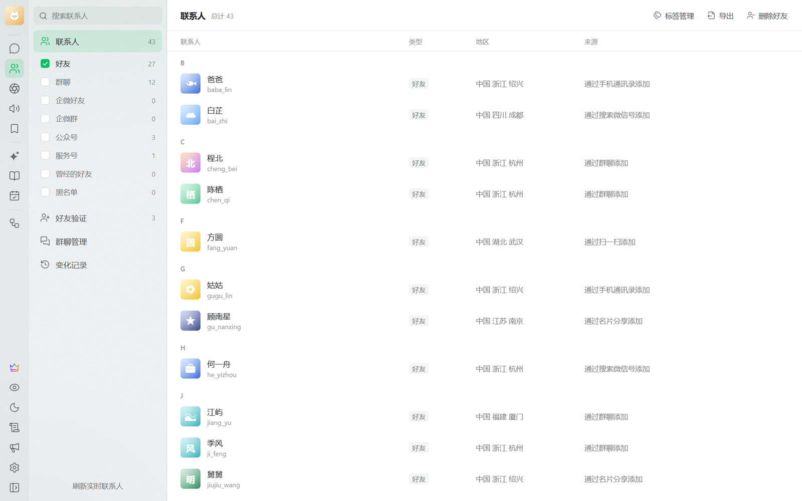</td>
    <td>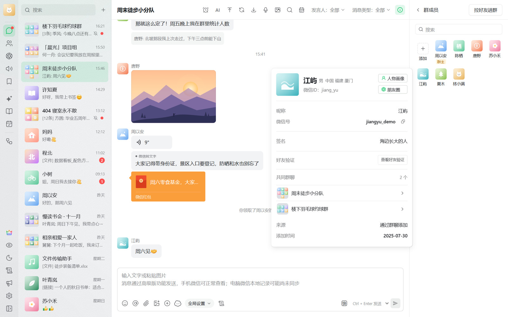</td>
  </tr>
  <tr>
    <td align="center"><b>朋友圈</b></td>
    <td align="center"><b>只看一位联系人</b></td>
  </tr>
  <tr>
    <td>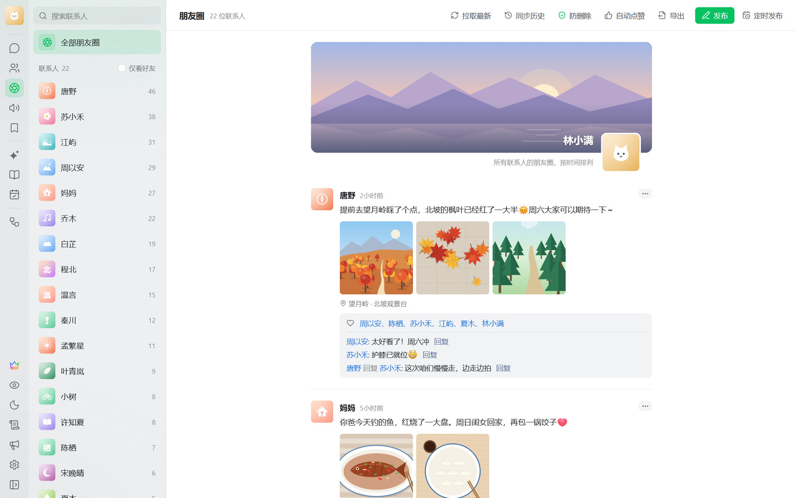</td>
    <td></td>
  </tr>
</table>

## 年度总结

这一年你的微信经历了什么、你是早八人还是夜猫子、今年打了多少字、反复说的词、谁是你秒回的置顶关心、每个月谁最懂你、表情包里藏了多少心情……年度总结可以切换年份、选择分享画幅，可以把当前页导出成图片，也可以把全部页面打包导出。

<table>
  <tr>
    <td align="center"><b>这一年的微信</b></td>
    <td align="center"><b>早八人还是夜猫子</b></td>
  </tr>
  <tr>
    <td>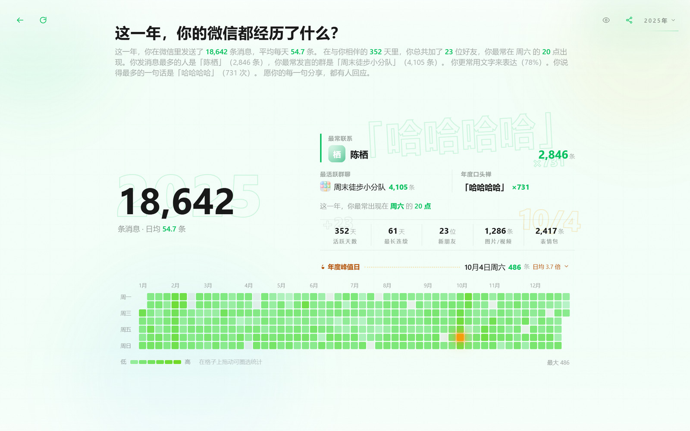</td>
    <td></td>
  </tr>
  <tr>
    <td align="center"><b>今年打了多少字</b></td>
    <td align="center"><b>陪你走过每个月的人</b></td>
  </tr>
  <tr>
    <td></td>
    <td>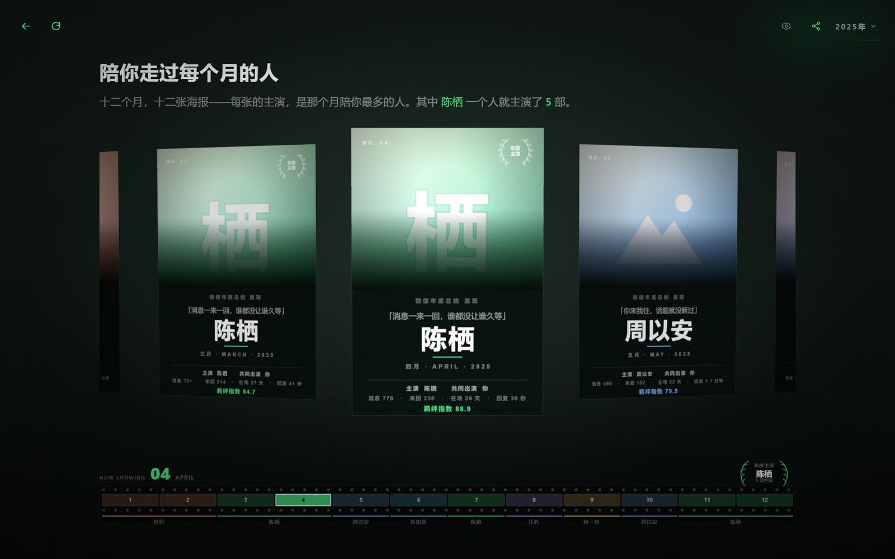</td>
  </tr>
</table>

   
  拖开卡包，全年最常发的表情包一张张飞出来

## 高级版功能

普通功能负责**读**：浏览、搜索、导出与年度总结；高级版在此基础上提供 **13 组 108 项高级版功能**：修改和补录聊天记录，在电脑上收发消息、管理群聊和联系人、参与朋友圈互动，还有 AI 助手、在线搜索和自动化任务，另有人工支持。

| 分组 | 项数 | 说明 |
| --- | :---: | --- |
| 消息修改 | 8 | 修改聊天记录里的消息，可以随时恢复原样 |
| 消息补录 | 17 | 在聊天记录里补录 17 类消息 |
| AI 与 MCP | 2 | AI 助手围绕聊天记录问答、总结，回答带消息出处；MCP 让 AI 客户端接入聊天数据 |
| 微信动作 | 22 | 发消息、文件、名片与各类卡片，引用回复、撤回、分组发图，以及收消息与历史补拉 |
| 红包与转账 | 4 | 在电脑上直接领红包、收转账，没收的转账可以退还；另可查看群红包领取明细 |
| 朋友圈 | 8 | 同步最新动态，点赞、评论与回复，图文或视频发圈与删除 |
| 群聊 | 14 | 建群、改群名与备注、发群公告与接龙、拉人进群与移除成员 |
| 联系人 | 11 | 改备注、加删好友、标签管理与找人 |
| 内容搜索 | 9 | 在线搜索公众号、服务号、小程序、视频号与直播；公众号文章可整号下载 |
| 视频号与直播 | 4 | 在线浏览作品、评论与关注列表，关注、点赞、评论，进直播间发言点赞 |
| 小程序 | 5 | 发送小程序卡片，登录授权、数据请求，链接与小程序码解析识别 |
| 自动化任务 | 3 | 定时群发、新好友自动处理与朋友圈跟圈 |
| macOS 取密钥 | 1 | 在 Mac 上获取数据库密钥，不限制微信版本，不用关闭 SIP |

  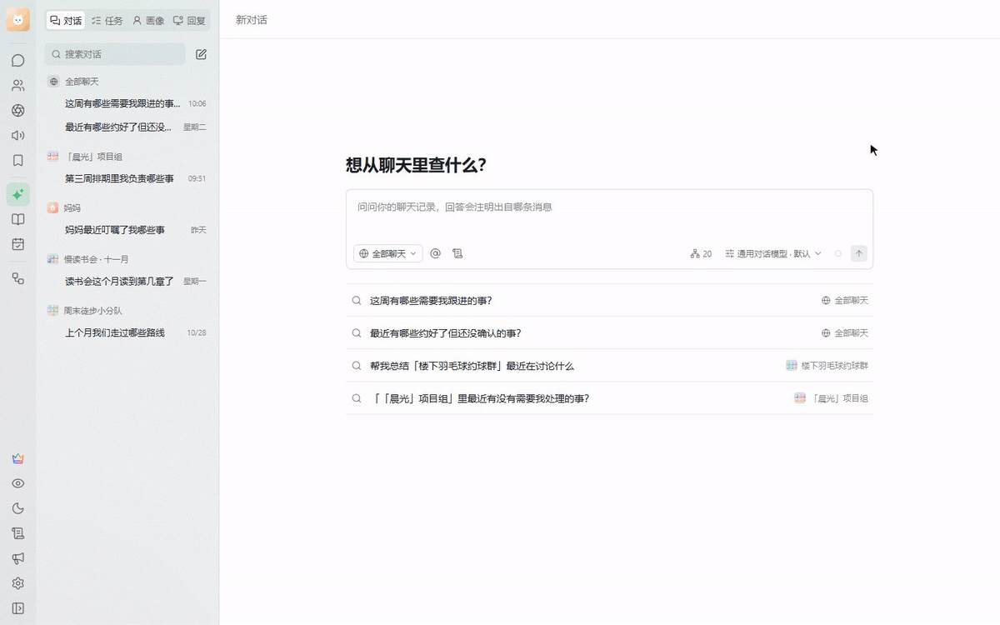 
  AI 助手：问「周末徒步小分队最近在聊什么」，它读完群聊记录后分段总结，每句话都标出对应的原消息

<b>展开查看全部 108 项</b>

| 分组 | 功能 |
| --- | --- |
| 消息修改（8） | 修改消息的文字、时间等，可以随时恢复原样；具体项目以应用内「全部功能」为准 |
| 消息补录（17） | 文字、图片、文件、语音、视频、表情等 17 类消息；具体项目以应用内「全部功能」为准 |
| AI 与 MCP（2） | AI 助手、MCP 接入 |
| 微信动作（22） | 发送文字消息、发送群聊 @ 消息、发送图片消息、发送视频消息、发送表情消息、发送文件消息、发送链接卡片、发送语音消息、发送拍一拍、会话已读 / 未读、会话免打扰、发送位置消息、发送联系人名片、引用回复、收藏表情浏览与发送、消息接收与历史补拉、个人二维码、撤回消息、图片视频分组发送、发送公众号文章、发送视频号卡片、折叠聊天 |
| 红包与转账（4） | 领取红包、转账收款、退还转账、群红包领取明细 |
| 朋友圈（8） | 朋友圈连续同步、朋友圈点赞、朋友圈图片评论、朋友圈文字评论、发布朋友圈、删除自己的朋友圈动态、删除朋友圈评论、回复朋友圈评论 |
| 群聊（14） | 修改本人群昵称、显示群成员昵称、群聊通讯录设置、发布群公告、新建群聊、修改群名称、拉好友进群、邀请成员进群、移除群成员、退出群聊、群成员批量加好友、修改群备注、群二维码、发起群接龙 |
| 联系人（11） | 修改好友备注、同意好友请求、删除好友、添加好友、新建联系人标签、设置联系人标签、读取联系人标签、重命名联系人标签、删除联系人标签、手机号 / 微信号找人、联系人变化记录 |
| 内容搜索（9） | 搜索公众号文章、搜索公众号、搜索视频号账号、搜索视频号内容、搜索视频号直播、搜索小程序、搜索服务号、公众号文章浏览与下载、微信链接解析 |
| 视频号与直播（4） | 视频号作品与评论；我关注的视频号；视频号关注、点赞与评论；直播间互动 |
| 小程序（5） | 发送小程序卡片、小程序登录授权、小程序数据请求、小程序链接解析、二维码与小程序码识别 |
| 自动化任务（3） | 定时群发任务、新好友自动处理、朋友圈跟圈任务 |
| macOS 取密钥（1） | macOS 100% 获取密钥 |

- 消息修改与补录的改动可以随时还原。发消息、朋友圈、群聊、联系人等在线功能需要先连接微信（见[开通会员与试用](#开通会员与试用)），不依赖本机微信客户端的版本。
- 108 项之外，开启消息防撤回和朋友圈防删除、知识库、下载本机没有的原图和视频、用访问令牌调用本机 HTTP API，以及添加新账号时校验数据库密钥和获取图片密钥，也需要会员或试用期。已经保留下来的撤回消息和朋友圈动态，到期后仍可查看。
- Windows x64、Windows ARM64、macOS（Apple 芯片）三个安装包都包含高级版功能；「macOS 取密钥」只用于 Mac。
- AI 助手使用你自己配置的模型服务，内置 DeepSeek、通义千问、Kimi、智谱 GLM、OpenAI、Claude、Gemini、OpenRouter、Ollama 等预设，也可以填写任意兼容接口。

### 开通会员与试用

1. 按[下载与安装](#下载与安装)装好 wuuud 并注册。**符合条件的新用户注册即送 1 天高级版免费试用**，试用期内大部分高级功能各可体验 1 次；能否领取、剩余时间和已体验的项目，以「会员中心」里的显示为准。
2. 想继续使用，在侧栏底部 **会员中心 → 开通会员** 选择套餐和绑定方式：绑定当前设备，可以在这台电脑上登录任意微信号；绑定本人微信账号，可以在任意电脑上登录这个微信号。
3. 扫码支付，到账自动开通，不自动续费。价格以应用内「开通会员」页为准；如果页面提示支付渠道暂不可用，请到 [Telegram 客服群](https://t.me/+tdhyuAoiuqAzNDJh) 联系购买。
4. 使用在线高级版功能前，打开 **会员中心 → 我的会员**，在「高级版功能连接」里连接微信，两种方式任选：
   - **扫码登录**：点「生成登录二维码」，用中国大陆版手机微信扫码并确认（海外版 WeChat 不支持）。
   - **提取登录状态**：点「提取登录状态」，打开电脑微信先不要登录，提示准备就绪后再登录（已经登录的要先退出）。在 Mac 上提取需要关闭 SIP，并使用从微信官网下载的微信；不方便关闭 SIP 时请用扫码。这一步和「macOS 取密钥」无关，取数据库密钥不用关闭 SIP。

> 试用或会员到期后，已经添加的微信账号仍可浏览、搜索、导出，实时更新和本地语音转文字也能继续用；添加新的微信账号、获取图片密钥、在设置里查看已保存的密钥需要会员或试用期。建议在试用期内把要查看的账号都添加好。

## 下载与安装

前往 **[Releases](https://github.com/Wuuud-ai/Wuuud/releases/latest)** 下载最新版本：

| 系统 | 设备 | 安装包 |
| --- | --- | --- |
| Windows | Windows 10 / 11，x64（Intel / AMD） | `wuuud-版本号-windows-amd64-setup.exe` |
| Windows | Windows 10 / 11，ARM64 | `wuuud-版本号-windows-arm64-setup.exe` |
| macOS | macOS 15 及以上，Apple 芯片（M 系列） | `wuuud-版本号-macos-arm64.dmg` |

> ARM64 安装包只能装在 ARM64 电脑上，Intel / AMD 电脑请下载 x64 安装包。暂不支持 Intel 芯片的 Mac。本仓库的 Releases 只提供 Windows 和 macOS 安装包，Linux 版请到 Telegram 群获取。Releases 里的 `-Setup.exe`、`-mac-arm64.dmg`、`.zip` 和 `.blockmap` 文件供应用内更新使用，按上表下载即可。

使用步骤：

1. 安装并打开 wuuud，用邮箱注册（验证后自动登录）或登录 wuuud 账号，阅读并同意使用须知。
2. 点「检测本机微信数据」，选择要查看的微信账号，点「读取此账号」。没检测到时，点「选择微信数据目录」，按提示选择这个微信账号的数据文件夹。
3. 获取数据库密钥，然后点「校验并继续」（需要在试用期或会员期内）：
   - **Windows**：点「一键获取数据库密钥」，在本机完成，不限次数。首选方式失败时，软件会询问是否换一种方式；换用的方式会重启微信、需要重新登录，可能触发微信的账号安全提醒，也可以不换，改为手动填写密钥。
   - **macOS**：点「获取高级版功能密钥」，按提示在电脑微信登录所选账号。试用期内只有 1 次机会，获取失败或中途取消也会用掉。
   - 也可以手动填写已有的密钥。
4. 图片密钥会尝试自动获取（需要在试用期或会员期内），也可以手动填写；可以点「跳过，直接查看聊天记录」，之后重新「读取此账号」补填。不填的话部分加密图片可能显示不出来。
5. 语音转文字是可选的，可以稍后再设置。完成后就可以查看聊天记录了。

> 获取密钥前，请只运行并登录一个电脑版微信；要查看的账号需要在这台电脑的微信上至少登录过一次。

- **macOS 首次打开**：如果系统提示无法验证开发者，请到「系统设置 → 隐私与安全性」，在下方找到 wuuud 并点「仍要打开」。
- **Windows 首次运行**：如果出现「Windows 已保护你的电脑」，点「更多信息 → 仍要运行」。
- **更新**：wuuud 会在应用内提示新版本，点「下载并安装」后自动下载、安装并重新打开；也可以在「设置 → 关于与诊断」里手动检查更新。如果旧版本一直没有收到更新提示，请从 [Releases](https://github.com/Wuuud-ai/Wuuud/releases/latest) 手动安装一次新版。
- **更新日志**：每个版本的变化见 [wuuud.com/changelog](https://wuuud.com/changelog)。

## 开发者接口

- **本机 HTTP API**（高级版功能）：用脚本或其他工具读取账号、会话、消息、联系人、朋友圈和媒体，订阅新消息，导出聊天记录。
- **MCP**（高级版功能）：让 Claude Code、Cursor、Cherry Studio 等 AI 客户端读取 wuuud 里的聊天数据。

在 **设置 → 接口与 MCP** 里复制接入地址和访问令牌；点同一页「接口文档」旁的「打开」可以查看完整的接口说明，文档页里可以「下载 AI 文档」交给 AI 阅读。默认只允许本机访问，每个请求都要带访问令牌，局域网访问需要手动开启。用访问令牌调用接口和使用 MCP 都需要会员或试用期，试用期内二者共用「MCP 接入」这一项的体验次数。

## 社区与反馈

- 官网：[wuuud.com](https://wuuud.com/)
- [Telegram 客服群](https://t.me/+tdhyuAoiuqAzNDJh)（群名显示为 WeChatDataAnalysis）：使用问题、会员与售后
- 问题反馈：在 [Issues](https://github.com/Wuuud-ai/Wuuud/issues) 写清系统、wuuud 版本和问题现象，并附上截图（截图前建议打开隐私模式）。**不要在 Issues 里上传日志**：日志里有微信号、会话和本机路径。需要日志时，在「设置 → 关于与诊断」打开日志目录，把 logs 文件夹压缩后私发给 Telegram 客服群的管理员。

## 免责声明

请在充分理解以下内容，并自愿承担相应责任的前提下使用本软件：

1. **软件性质**：wuuud 是非官方工具，与微信、腾讯及其关联主体不存在隶属、授权、合作或认可关系。相关产品名称和商标归其权利人所有。
2. **合法使用**：本软件仅可用于处理使用者本人合法持有、管理或已经取得明确授权访问的数据。使用者应遵守适用的法律法规、软件许可协议、平台规则和隐私保护义务。
3. **数据与备份**：使用过程会读取和处理本机的微信数据和密钥。开始前请备份重要数据、密钥及配置，并自行负责密钥保管、数据安全和隐私保护。
4. **兼容性与运行风险**：微信版本变化、第三方组件及其他本地处理流程，可能导致账号提醒、功能失效、处理失败、文件异常或其他不可预期的结果。本软件不保证对未来微信版本持续兼容。
5. **责任范围**：本软件按现状提供，不对功能的准确性、完整性、稳定性或持续可用性作出明示或默示保证。在适用法律允许的范围内，因使用、误用、版本不兼容、操作中断或第三方策略变化产生的损失和后果，由使用者自行承担。

使用或继续使用本软件，即表示你已经阅读、理解并同意以上内容，并愿意对自己的操作及其结果负责。

## 致谢

wuuud 基于开源项目 [WeChatDataAnalysis](https://github.com/LifeArchiveProject/WeChatDataAnalysis) 开发。本仓库只发布安装包，不包含源码。感谢以下项目和贡献者：

1. [H3CoF6](https://github.com/H3CoF6)
2. [echotrace](https://github.com/ycccccccy/echotrace)
3. [WeFlow](https://github.com/hicccc77/WeFlow)
4. [oh-my-wechat](https://github.com/chclt/oh-my-wechat)
5. [vue3-wechat-tool](https://github.com/Ele-Cat/vue3-wechat-tool)
6. [wx-dat](https://github.com/waaaaashi/wx-dat)
7. [Ritsu](https://www.xiaohongshu.com/user/profile/611a8eb70000000001000250)
8. [recarto404](https://github.com/recarto404)
9. [xiaoshengbao](https://github.com/xiaoshengbao)
